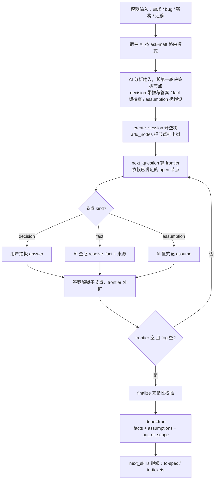
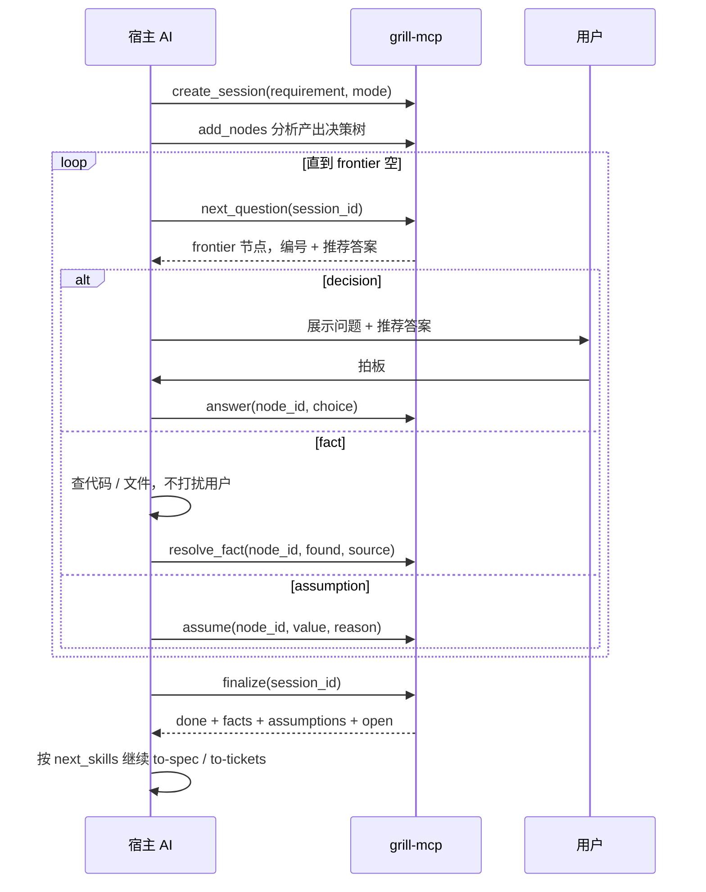

# grill-mcp

需求澄清访谈引擎 MCP（**模式路由 + 纪律约束**）。宿主 AI 收到模糊输入后，先按**模式**路由（需求拆解 / Bug 分析 / 理解架构 / 大型迁移），再和用户逐题确认。MCP 本身不做推理，而是用**确定性规则逼着 AI 把需求问透**：每个待拍板点必须挂在决策树上、依赖未满足不许问、该 AI 查的事实不许甩给用户、封箱前不许有「偷偷假设」。最后产出不可含糊的事实清单并落盘。

## 定位：一个「带规则的桶」

把 MCP 想成流水线上的**桶 + 质检关卡**（Model A：AI 分析 + MCP 守纪律）：

- **AI 负责「筛」**：用 grilling / diagnosing-bugs / domain-modeling 等 skill 分析模糊输入，把它长成一棵决策树、查证事实、给推荐答案。
- **MCP 负责「管 + 打包」**：桶壁上的规则让 AI 偷不了懒；`finalize` 封箱前强制清点，产出 `facts + assumptions + out_of_scope` 三张清单。

少了关卡，流水线产出的就是没质检的次品——也就是「不够严谨」的根源。

## 设计流程



## 程序流程



## 模式

模式不再内置固定问题列表，只决定**路由提示 + 该用什么 skill + 产出形态**；问题由宿主 AI 按模式对应的纪律现场长出。

| mode | 什么时候用 | 对应纪律 | finalize 产出 |
|---|---|---|---|
| `requirement` 需求拆解 | 新功能 / 跨模块改动 / 边界不清 | grilling：本质→归属→复用→新增→接口→流程→影响 长树 | 方案写法 |
| `bug` Bug 分析 | 报错 / 偶发 / 性能回归 / 数据不对 | diagnosing-bugs：复现回路 + 证据 gate 住根因 | 根因 + 修复 + 回归测试 |
| `architecture` 理解架构 | 术语混乱 / 边界模糊 / 锁决策 | domain-modeling：术语 + ADR | CONTEXT.md 术语 + ADR |
| `migration` 大型迁移 | 大型迁移 / 路径不明 | wayfinder：目的地 / fog / frontier | 决策地图 |
| `free` 自由 | 宿主 AI 已分析好 | 全由 AI add_nodes 传入 | 任意 |

> `bug` 模式强调**证据驱动**：`root_cause` 节点必须 `depends_on=[feedback_loop, evidence]` 且二者为 `kind=fact`（AI 先建复现回路、拿到证据，才允许谈根因），从机制上禁止跳到猜测。

## 纪律（桶壁上的规则）

- **决策树**：节点挂成树（`parent_id`），答案会长出新枝，不是平铺列表。
- **frontier 门槛**：`next_question` 只返回依赖已满足的 open 节点；依赖未满足的进 fog，解锁后才毕业。
- **fact / decision 分流**：`fact` 节点 AI 必须自己查证（`resolve_fact`），不许丢给用户；只有 `decision` 才问用户。
- **推荐答案**：AI 每长一个 `decision` 节点，必须给 `recommended` + `why`（先做过功课、先表态）。
- **nothing assumed**：假设只能显式记（`assume`）；`finalize` 时 frontier 未空 / 有 fact 未查 / 有假设未标，一律 `done=false`，并把没封住的东西列出来。

## 工具

| 工具 | 说明 |
|---|---|
| `list_modes` | 列出可用模式（含 when_to_use / skills 路由提示） |
| `create_session(requirement, mode?)` | 开一个**空树**会话（不再灌固定题） |
| `add_nodes(session_id, nodes[])` | AI 分析产出，往树上长节点 |
| `next_question(session_id)` | 算 frontier：返回依赖已满足的 open 节点 + `action` + `cue` |
| `answer(session_id, node_id, choice, note?)` | 用户拍板一个 decision 节点；返回后 `brief.next` 直接给下一节点 |
| `resolve_fact(session_id, node_id, found, source?)` | AI 记录查证结果 + 来源；返回后 `brief.next` 直接给下一节点 |
| `assume(session_id, node_id, value, reason?)` | AI 显式记录一条假设；返回后 `brief.next` 直接给下一节点 |
| `mark_out_of_scope(session_id, node_id, reason?)` | 标记「明确不做」 |
| `get_status(session_id)` | 看树 + 五格视图（resolved / assumptions / pending / fog / out_of_scope）+ `brief` |
| `finalize(session_id, write?, output_dir?)` | 完备性校验 + 收敛成事实清单，可落盘 |
| `list_sessions` | 列出所有会话（运维排查） |

`add_nodes` 节点格式：

```json
{"id": "batch_size", "parent_id": "flow", "kind": "decision", "question": "批量多大？", "recommended": "单次 ≤200", "why": "避免长事务锁表", "options": ["≤200", "≤1000"], "depends_on": ["flow"], "output": ""}
```

- `id` 唯一；`question` 必填；`kind` 默认 `decision`。
- `kind`：`decision`（用户拍板）/ `fact`（AI 查证）/ `assumption`（AI 记假设）。
- `decision` 节点 **`recommended` 必填**（建议带 `why`）。
- `parent_id` / `depends_on` 决定树形与 frontier；`options` 可选。
- `output` 落盘路由：`term`（进 CONTEXT.md 术语表）/ `decision`（写 ADR）；缺省为空（进方案文件正文）。

## 现场简报 brief

每个工具（`next_question` / `answer` / `resolve_fact` / `assume` / `mark_out_of_scope` / `get_status` / `finalize`）返回都带一个 `brief`，让 AI 每次调用都锚定「需求 + 已拍板 + 下一步 + 规则」，不用靠自己的上下文记忆：

```json
{
  "requirement": "给任务管理列表加批量改标签",
  "mode": "requirement",
  "settled": ["essence: 批量改标签", "existing_api: POST /api/tag/v1/batch", "perf: ~批量无性能问题"],
  "next": {"action": "ask_user", "node_id": "batch_size", "question": "批量多大？", "recommended": "单次 ≤200", "cue": "只把这一句转给用户，不加开场白、不总结、不追问别的"},
  "rule": "grilling：…；一次只做一件事，不总结、不追问"
}
```

- `settled`：已拍板摘要（`id: 值`）；假设前缀 `~` 标出「未证实」。
- `next`：下一个 frontier 节点；`action` 按 kind 分流 —— `decision`→`ask_user`、`fact`→`look_up`、`assumption`→`assume`、依赖未满足→`blocked`。闭环时为 `null`。
- `cue`：附在该节点上的行为指令，推着 AI 只做这一步、不废话。
- `rule`：当前模式的纪律（来自 `modes.json` 的 `discipline`）。

因为 `answer` / `resolve_fact` / `assume` 落点后 `brief.next` 直接给出下一节点，AI 多数时候**不需要再调 `next_question`**，少一次往返。

## 安装与启动

```bash
uv sync                                  # 安装依赖
uv run python server.py                  # stdio（默认，由 MCP 客户端拉起）
GRILL_MCP_TRANSPORT=streamable-http uv run python server.py   # HTTP 模式，便于手工调试
```

> stdio 模式是给 MCP 客户端 spawn 用的，手工前台跑会阻塞在 stdin 上；停掉用 Ctrl+D（EOF）或 `pkill -f "uv run python server.py"`。

## 集成到 agent

MCP 服务器本身只是一个进程（stdio 下是子进程，HTTP 下是独立进程）。把它注册进 agent 的 MCP 配置后，agent 启动时拉起它、发现它的 11 个工具，之后就能像调用内置工具一样调用 `create_session` / `add_nodes` / `answer` / `finalize` 等。

### Qoder（本环境，已验证）

编辑 `~/.qoder/settings.json`，在 `mcpServers` 里加一条（`command` 用绝对路径，`args` 指到本项目目录）：

```json
{
  "mcpServers": {
    "grill-mcp": {
      "command": "/Users/xuxinzhi/.local/bin/uv",
      "args": [
        "run",
        "--directory",
        "/Users/xuxinzhi/Documents/gowork/tools/grill-mcp",
        "python",
        "server.py"
      ]
    }
  }
}
```

改完重启 Qoder（或重连 MCP），grill-mcp 的 11 个工具就会出现在工具列表里。

> 同机的 `apifox`、`feishu` 两个 MCP 也是这么注册的，可直接照抄格式。

### 其他客户端（通用 mcpServers 格式）

各客户端都接受同一种 `mcpServers` 映射，只是落在不同配置文件：

| 客户端 | 配置文件 |
|---|---|
| Qoder | `~/.qoder/settings.json` 的 `mcpServers` |
| Claude Desktop | `~/Library/Application Support/Claude/claude_desktop_config.json` |
| Codex | `~/.codex/config.toml` 的 `[mcp_servers.grill-mcp]`（`command` + `args` 数组） |
| Cursor | 项目根 `.cursor/mcp.json` |

### HTTP 模式（streamable-http）

先单独起服务，再以 `url` 方式注册（适用于飞书智能体等需要公网/内网可达的 agent）：

```bash
GRILL_MCP_TRANSPORT=streamable-http uv run python server.py
# 监听 http://127.0.0.1:8000/mcp（启动日志会打印实际路径）
```

```json
{ "mcpServers": { "grill-mcp": { "url": "http://127.0.0.1:8000/mcp" } } }
```

> stdio 模式由 agent 负责 spawn，最适合本地 Qoder/Claude Desktop；HTTP 模式适合服务化、多人或多端复用，需自行处理鉴权（`token` 字段预留）。

## 配置

复制 `config.example.json` 为 `config.json`（可选，缺省值即可跑）：

| 字段 | 默认 | 说明 |
|---|---|---|
| `transport` | `stdio` | `stdio` 或 `streamable-http` |
| `host` / `port` | `127.0.0.1` / `8000` | streamable-http 监听地址 |
| `token` | 空 | 预留 |
| `session_db` | `~/.qoder/grill-mcp/sessions.db` | SQLite 会话库 |
| `output_dir` | `~/.qoder/grill-mcp/outputs` | finalize 落盘根目录 |

## 使用示例

```bash
# 1. 开一个空树会话（mode 默认 requirement）
create_session(requirement="给任务管理列表加批量改标签")

# 2. AI 分析后长第一轮节点（decision 带推荐答案，fact 标待查）
add_nodes(session_id, [
  {"id": "essence", "kind": "decision", "question": "本质是什么？", "recommended": "批量改已有任务标签，不是新任务类型", "why": "决定接口走更新还是新建"},
  {"id": "existing_api", "kind": "fact", "question": "现有标签更新接口是哪个？"}
])

# 3. next_question 取 frontier，按 action 分流：decision 问用户，fact 自己查
next_question(session_id)          # → node=essence, action=ask_user, cue=「只把这一句转给用户…」
answer(session_id, "essence", "批量改标签")        # 返回 brief.next 直接给下一节点
resolve_fact(session_id, "existing_api", "POST /api/tag/v1/batch", "grep handler 定位到")

# 4. answer/resolve/assume 落点后 brief.next 已给出下一步，继续直到 brief.next 为 null

# 5. 完备性校验 + 落盘
finalize(session_id, write=True, output_dir="/path/to/project")
```

`finalize` 返回：

```json
{
  "done": true,
  "markdown": "# 需求：…\n> 核心结论：…",
  "facts": [{"id": "essence", "question": "…", "choice": "…"}],
  "assumptions": [{"id": "perf", "value": "批量 ≤200 无性能问题", "confirmed": false}],
  "out_of_scope": [],
  "open": [],
  "next_skills": ["to-spec", "to-tickets"],
  "brief": {"requirement": "…", "settled": ["…"], "next": null, "rule": "…"},
  "written": ["/path/to/project/<slug>-方案.md", "…/CONTEXT.md", "…/docs/adr/0001-<slug>.md"]
}
```

- `done=true` 需同时满足：frontier 空、fog 空、无未查的 fact。
- `assumptions` 显式列出「假设了但没证实」的项；不算错，但必须看得见。
- 未闭环（`done=false`）也可 finalize，`open` 列出还问不清的项，宿主 AI 据此决定是否继续。
- `next_skills` 是宿主 AI 拿到 facts 后**接着要调用的 skill**（来自模式的 `skills.after`）。

## Skill 架构

skill 是**一等字段**，写在 `templates/modes.json` 的每个模式里，而不是散在文档：

```json
"skills": {
  "analyze": "grilling / grill-with-docs",
  "after": ["to-spec", "to-tickets"]
}
```

- `analyze`：进入访谈前，宿主 AI 用来分析输入、长出决策树节点的 skill。
- `after`：finalize 后，宿主 AI 依据 facts 接着执行的 skill（通过 `finalize` 返回的 `next_skills` 暴露）。

| 模式 | analyze | after（next_skills） |
|---|---|---|
| `requirement` 需求拆解 | grilling / grill-with-docs | to-spec → to-tickets |
| `bug` Bug 分析 | diagnosing-bugs | （无：根因+修复+回归已进 facts） |
| `architecture` 理解架构 | domain-modeling / codebase-design | （无：术语进 CONTEXT.md、决策进 ADR） |
| `migration` 大型迁移 | wayfinder | to-spec → to-tickets |
| `free` 自由 | 任意 | （无） |

路由由宿主 AI 的 ask-matt 逻辑完成（`list_modes` 的 `when_to_use` 提供提示）。grill-mcp 只产出**事实**（facts + assumptions + open + out_of_scope）；spec / tickets / 修复动作由宿主 AI 依据 `next_skills` 继续生成。

## 目录结构

```
grill-mcp/
├── server.py            # FastMCP 入口，注册 11 个工具
├── interview.py         # 决策树状态机（树 + frontier + 完备性校验 + next_skills）
├── factsheet.py         # 方案写法渲染 + 三类文件落盘
├── session_store.py     # SQLite 会话持久化
├── templates/modes.json   # 模式（requirement/bug/architecture/migration/free，含 skills + 纪律提示）
├── tests/test_interview.py    # 单测
├── config.example.json
└── pyproject.toml
```

## 测试

```bash
uv run python -m unittest discover -s tests
```
